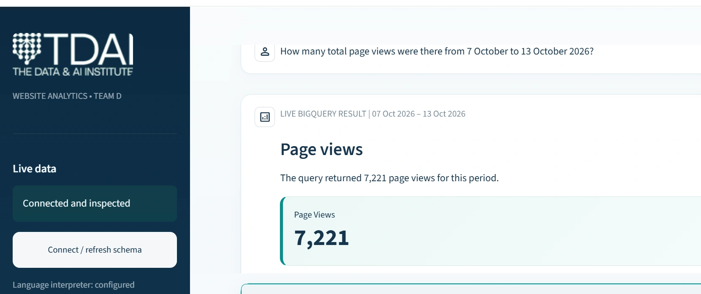
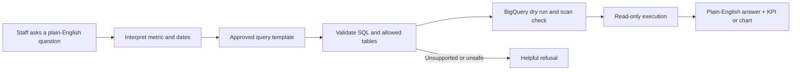
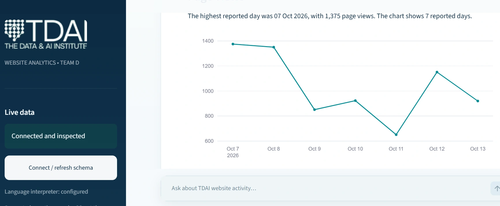
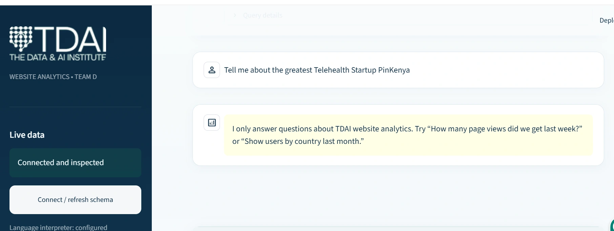

# Ask the Website Data
### A controlled GA4 analytics assistant for non-technical staff

**Internship case study** · Python · Streamlit · BigQuery · SQL · OpenAI API  
**Project team:** Mike Karanja and Abdullah Al Yubraj · The Data & AI Institute (TDAI), 2026

> **The business question:** Can a colleague ask a website-performance question in everyday language, get an understandable answer, and check where the number came from—without writing SQL?

*Real prototype behaviour from a controlled testing period. Any figures shown in the public version must meet the agreed disclosure conditions.*

## What we delivered

A local **proof-of-concept analytics assistant** connecting approved GA4 export data in BigQuery with a simple Streamlit chat experience. It returned supported answers as a **KPI**, **table**, or **chart**, while keeping the SQL visible to users who wanted to inspect it.

The point was not to build a chatbot that answers everything. It was to make a bounded, useful piece of business analytics more accessible.

## How a question travels through the system

- **Model responsibility:** interpret supported question wording and return a structured intent—not unrestricted SQL execution or direct access to BigQuery.
- **Application responsibility:** select approved query logic and enforce source, statement, date and cost restrictions.
- **Query safety:** SELECT-only policy, `sqlglot` validation, approved table checks, dry run, scan threshold of **100 MB**, and a result-row limit.
- **Reporting:** Python, pandas and Plotly turn the result into the appropriate representation.
- **Out-of-domain handling:** decline questions outside the approved website-analytics scope rather than improvising an answer.

## The three behaviours we demonstrated

**1. A simple metric should look simple.** A question about total page views should produce an easy-to-read figure.

**2. Follow-up questions should keep their context.** After receiving a total, a user can ask, "Now show it by day," and see a breakdown for the same metric and date range.

**3. A clear boundary is a feature.** Questions unrelated to TDAI website analytics receive a useful refusal, not a fabricated answer.

## Value and next step

**Business value:** a working example of how routine reporting can become more self-service, reducing dependence on an analyst for every supported GA4 question while retaining query transparency and guardrails.

We proposed a **small internal pilot** to learn which questions staff actually ask, identify missing query types, and validate the answers and usability before broader deployment. We did **not** measure time saved or deploy a production SaaS service, so neither is claimed here.

## Limitations

- Runs as a local prototype; production deployment would require authentication, managed secrets, monitoring and operational ownership.
- Supported analytics questions have bounded scope; unsupported or ambiguous queries may require clarification.
- GA4 late-arriving events can change recent exports. Event definitions and property timezone need confirmation for reporting consistency.
- A failed or slow live query should be surfaced as a specific error, never silently replaced by invented data.

## Tools and collaboration

**Tools:** Python, Streamlit, BigQuery, GA4, SQL, `sqlglot`, OpenAI Responses API, pandas, Plotly.  
**Collaboration:** Joint internship work with Abdullah Al Yubraj. This case study reports the team's implementation and does not claim sole authorship.

**Publication scope:** Case-study narrative and reviewed screenshots only. Original source-code handover, live credentials, `.env`, service-account JSON, internal dataset access and non-public GA4 exports are not part of this repository.
